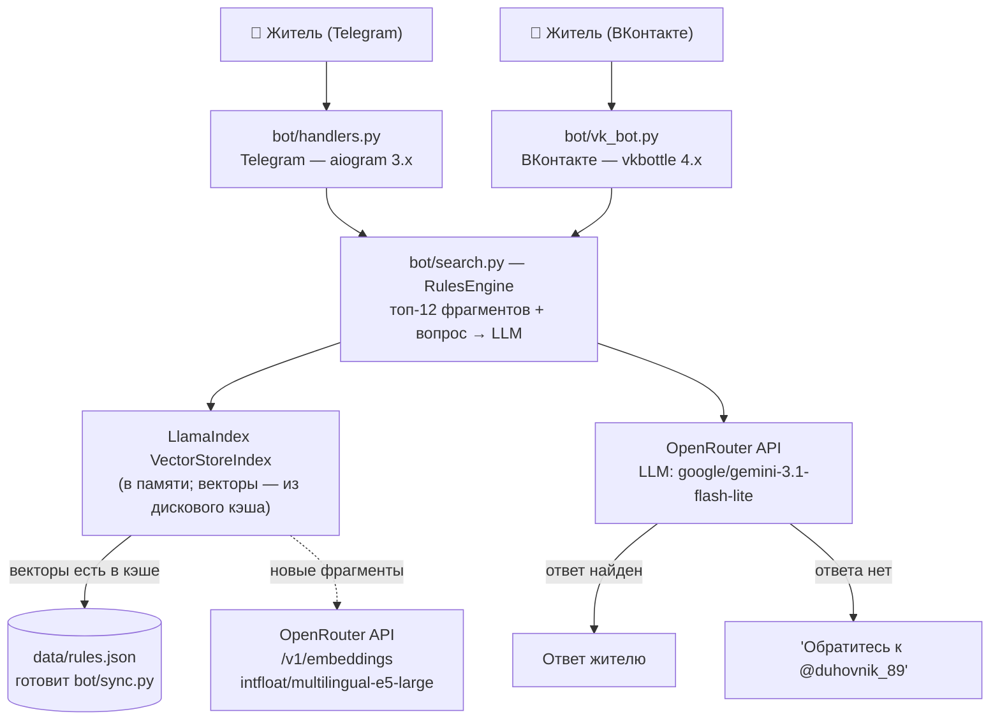

# Нейро-консультант по своду правил поселения "Междуречье"

Бот для жителей поселения Междуречье — работает в Telegram и ВКонтакте.
Отвечает на вопросы о решениях общего собрания, опираясь на RAG-поиск по архиву документов.

## Что умеет

- Отвечает на вопросы о правилах, взносах, решениях собраний — на основе официального Excel-архива
- Работает одновременно в Telegram и ВКонтакте
- Если ответа в документах нет — направляет к администратору @duhovnik_89
- Понимает вопросы в свободной форме, без ключевых слов, включая уточняющие вопросы в диалоге

## Как это работает (RAG)

При старте бот разбивает архив на фрагменты-записи, векторизует их и строит в
памяти индекс (LlamaIndex `VectorStoreIndex`). На каждый вопрос векторным поиском
достаются ~12 самых близких к вопросу фрагментов — только они вместе с вопросом
уходят в LLM. Модель работает с релевантной выжимкой: ответ быстрее, дешевле и
точнее.

Эмбеддинги считаются не локально, а через API OpenRouter (OpenAI-совместимый
`/v1/embeddings`, модель `intfloat/multilingual-e5-large`) — поэтому в проекте
нет PyTorch и многомегабайтных моделей. Векторы фрагментов кэшируются на диск
(`data/rules.embeddings.npz`): после первого запуска индекс собирается вообще
без вызовов API, а при обновлении архива доэмбеддируются только изменённые записи.

```
Excel (rules.xlsx)
    ↓ bot/sync.py (запускать при обновлении Excel)
rules.json — плоский список записей «лист — дата — текст»
    ↓ при старте бота (bot/source.py: файл или бакет)
RulesEngine — чанкинг → эмбеддинги (OpenRouter API, с дисковым кэшем)
              → VectorStoreIndex в памяти
    ↓ при каждом вопросе: векторный поиск топ-12 фрагментов
LLM через OpenRouter → ответ жителю
```

## Архитектура



Детали RAG (bot/search.py):
- Фрагмент по умолчанию — запись Excel целиком (готовая смысловая единица); записи длиннее ~800 символов режет `SentenceSplitter`
- Эмбеддинг-модель — `intfloat/multilingual-e5-large` через OpenRouter API; e5-префиксы «query: »/«passage: » дописывает бот (`PrefixedOpenAIEmbedding`)
- Дисковый кэш векторов: ключ — хэш текста фрагмента, смена модели/сервера сбрасывает кэш целиком
- Уточняющий вопрос («а если их десять?») перед поиском дополняется последними репликами жителя из истории
- Дубли из хронологии и тематических листов отбрасываются после поиска (`LongContextReorder` расставляет лучшие фрагменты по краям контекста)
- Эмбеддер и индекс — общие для Telegram- и VK-движков одного процесса; отказ API при старте не роняет бот — сборка повторится на следующем вопросе

## Структура проекта

```
bot-mezhdureche/
├── main.py              — точка входа: asyncio.gather(telegram, vk_thread)
├── requirements.txt
├── .env.example         — шаблон переменных окружения
├── architecture.mmd     — диаграмма архитектуры (Mermaid)
├── config/
│   └── settings.py      — константы, load_dotenv(), настройки RAG
├── bot/
│   ├── handlers.py      — Telegram-хендлеры (Router), /start /help /about
│   ├── vk_bot.py        — VK-хендлеры (BotLabeler) + run_vk_bot()
│   ├── search.py        — RulesEngine: RAG-индекс + векторный поиск + LLM
│   ├── sync.py          — openpyxl → rules.json (запускать отдельно при обновлении Excel)
│   └── source.py     — откуда взять rules.json: бакет Object Storage или файл
└── data/
    ├── rules.xlsx                — архив решений (не в git)
    ├── rules.json                — подготовленный архив (не в git, генерируется sync.py)
    └── rules.embeddings.npz      — кэш векторов фрагментов (не в git, генерируется ботом)
```

## Как запустить

**1. Установить зависимости**
```bash
python -m venv .venv
.venv/Scripts/pip install -r requirements.txt   # Linux/Mac: .venv/bin/pip
```

**2. Настроить переменные окружения**
```bash
cp .env.example .env
# заполнить .env: TELEGRAM_BOT_TOKEN, VK_TOKEN, OPENROUTER_API_KEY
```

**3. Подготовить архив из Excel** (нужно при первом запуске и при обновлении файла)
```bash
python -m bot.sync
```

**4. Запустить бота**
```bash
python main.py
```

Первый запуск построит индекс: ~6 запросов к OpenRouter на векторизацию 290 фрагментов
(доли копейки) и сохранит векторы в кэш. Следующие старты собирают индекс из кэша — без
обращений к эмбеддинг-API. При обновлении `data/rules.xlsx` — снова `python -m bot.sync`,
затем перезапустить бот (если работает бакет Object Storage — достаточно залить свежий
rules.json, бот подхватит его сам, а кэш доэмбеддит только новые записи).

## Контакты

Поселение Междуречье — для жителей, от жителей.
