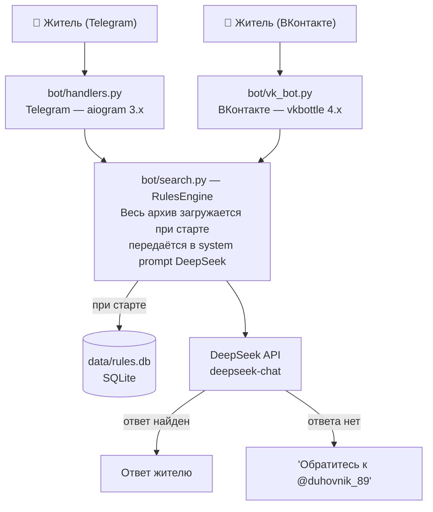

# Нейро-консультант по своду правил поселения "Междуречье"

Бот для жителей поселения Междуречье — работает в Telegram и ВКонтакте.
Отвечает на вопросы о решениях общего собрания, опираясь на полный архив документов.

## Что умеет

- Отвечает на вопросы о правилах, взносах, решениях собраний — на основе официального Excel-архива
- Работает одновременно в Telegram и ВКонтакте
- Если ответа в документах нет — направляет к администратору @duhovnik_89
- Понимает вопросы в свободной форме, без ключевых слов

## Как это работает

При старте бот загружает весь архив решений (~256 записей) в память и передаёт его DeepSeek AI как контекст при каждом вопросе. Никакого поиска по ключевым словам — модель сама находит нужное решение в полном тексте.

```
Excel (rules.xlsx)
    ↓ bot/sync.py (запускать при обновлении Excel)
SQLite (rules.db)
    ↓ при старте бота
RulesEngine — весь архив в system prompt
    ↓ при каждом вопросе
DeepSeek API → ответ жителю
```

## Архитектура



## Структура проекта

```
bot-mezhdureche/
├── main.py              — точка входа: asyncio.gather(telegram, vk_thread)
├── requirements.txt
├── .env.example         — шаблон переменных окружения
├── architecture.mmd     — диаграмма архитектуры (Mermaid)
├── config/
│   └── settings.py      — константы, load_dotenv()
├── bot/
│   ├── handlers.py      — Telegram-хендлеры (Router), /start /help /about
│   ├── vk_bot.py        — VK-хендлеры (BotLabeler) + run_vk_bot()
│   ├── search.py        — RulesEngine: загрузка архива + DeepSeek API
│   └── sync.py          — openpyxl → SQLite (запускать отдельно при обновлении Excel)
└── data/
    ├── rules.xlsx        — архив решений (не в git)
    └── rules.db          — SQLite база (не в git, генерируется sync.py)
```

## Как запустить

**1. Установить зависимости**
```bash
pip install -r requirements.txt
```

**2. Настроить переменные окружения**
```bash
cp .env.example .env
# заполнить .env: TELEGRAM_BOT_TOKEN, VK_TOKEN, DEEPSEEK_API_KEY
```

**3. Импортировать Excel в базу** (нужно при первом запуске и при обновлении файла)
```bash
python -m bot.sync
```

**4. Запустить бота**
```bash
python main.py
```

При обновлении `data/rules.xlsx` — снова запустить `python -m bot.sync`, затем перезапустить бот.

## Контакты

Поселение Междуречье — для жителей, от жителей.
