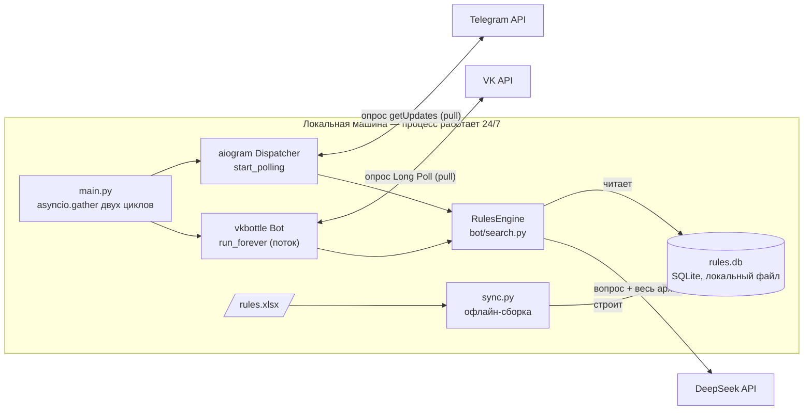
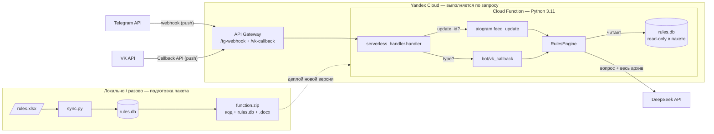

# Архитектура бота: AS IS → TO BE (Yandex Cloud Serverless)

Две схемы: как бот устроен **сейчас** (локальный процесс с long-polling) и как
он будет устроен **после переноса** на бессерверный стек Yandex Cloud.

> Обе диаграммы в Mermaid. GitHub рисует их автоматически. Можно также вставить
> код любого блока в https://mermaid.live и посмотреть/поправить.

---

## AS IS — сейчас (локальный запуск)

Главное: на машине крутится **постоянный процесс**, который сам **опрашивает**
(pull) Telegram и ВК. Пока процесс не запущен — бот не работает.

---

## TO BE — после переноса (Yandex Cloud Serverless)

Главное: процесса 24/7 больше нет. Платформы сами **присылают** (push) события
через webhook в API Gateway, тот будит **функцию** только на время обработки.
БД едет внутри пакета и открывается только на чтение.

---

## Что именно меняется

| | AS IS (сейчас) | TO BE (serverless) |
|---|---|---|
| Модель получения событий | **Pull** — бот сам опрашивает Telegram/ВК | **Push** — платформы шлют события в шлюз |
| Где живёт | Постоянный процесс на машине 24/7 | Функция, просыпается на запрос |
| Точка входа | `main.py` + два вечных цикла | API Gateway → `serverless_handler.handler` |
| Telegram | aiogram `start_polling` | webhook → `feed_update` |
| ВКонтакте | vkbottle `run_forever` (long-poll) | VK Callback API → `vk_callback` |
| База `rules.db` | локальный файл, читается | тот же файл в пакете, открыт `mode=ro` |
| Сборка БД (`sync.py`) | на той же машине | локально/разово, результат кладётся в zip |
| Оплата | за работающую машину постоянно | за время выполнения (в пределах free tier ≈ 0 ₽) |
| Что не меняется | — | `handlers.py`, `search.py`, `sync.py`, логика DeepSeek |

> Бизнес-логика (обработчики Telegram, движок DeepSeek, сборка БД) переезжает
> почти без изменений. Меняется только **слой входа**: вечные циклы опроса → один
> webhook-адаптер, который будит функцию.
